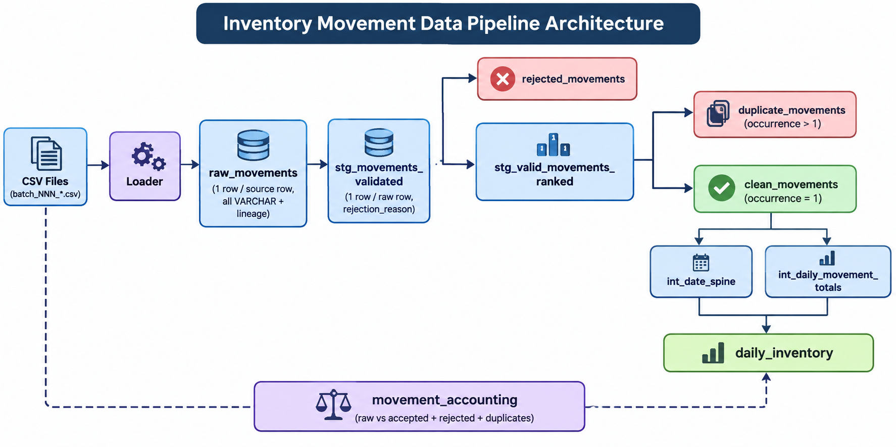

# Inventory movement pipeline (dbt Core + DuckDB)

A small batch pipeline that turns warehouse inventory movement files into validated movements and
daily inventory balances per product and warehouse. It runs fully locally: no server, no credentials.

| | Link |
|---|---|
| GitHub repository | https://github.com/ultranet1/inventory_pipeline.git |
| Loom walkthrough | https://www.loom.com/share/33998686d92a4307b9fb61c13a8a91f3 |

**Access:** both links are public; no sign-in is needed. If either is ever made private, request access from the
repository owner (GitHub: open an issue or ask to be added as a collaborator; Loom: use "Request access" on the video
page) and access will be granted to reviewers.



---

## Reproduce the sample results (about 3 minutes)

```bash
python3 -m venv .venv && source .venv/bin/activate && pip install -r requirements.txt
python scripts/fixture_results.py           # fixture: first run, rerun, late batch -> fixture/actual/, compared with fixture/expected/
scripts/demo_phase5.sh                      # rerun safety and late-arrival before/after values, asserted
python scripts/verify_queries.py --scale    # both reporting queries vs the fixture + checks on the generated data
scripts/run_pipeline.sh --reset data/sample/batch_001.csv data/sample/batch_002_late.csv && python scripts/snapshot.py --counts-only
```

Each command exits non-zero if a result differs from what this README states. Full setup and every command: Sections 1 and 2.

## Requirements checklist

How each requirement of the brief is met, with the file or section that shows it: `docs/requirements_checklist.md`.

## Decisions and tradeoffs

A summary of the choices the brief leaves open; details are in the sections linked.

| Decision | Choice | Main tradeoff |
|---|---|---|
| **Validation order and rejection reasons** (Section 5) | Fixed rule order, first failing rule wins, so each invalid row has exactly one reason. Every raw row ends in exactly one bucket (accepted, rejected or duplicate), and `movement_accounting` plus `assert_row_accounting` prove accepted + rejected + duplicates = raw. | Easy to reconcile and to count by reason, but a row with several defects shows only the first one. |
| **Duplicates** (Section 5) | Only valid rows are deduplicated, by `movement_id`, first delivery wins (file name, then line). Invalid rows are counted per source row. A re-send with different content fails the build. | Invalid rows sent twice count as two rejections, which matches "one row per source row". "First" depends on files being named in delivery order. Failing on conflicts is strict: a bad re-send stops the run until someone decides. |
| **Timezone and business dates** (Section 5) | Source timestamps read as UTC, business date taken in UTC; both are dbt vars. | UTC has no daylight-saving jumps and needs no per-warehouse setting. A warehouse in another timezone may see a late-evening movement on the next day; changing the var fixes that for all warehouses at once, not per warehouse. |
| **Days without activity** (Section 6) | A date spine per product/warehouse from its first movement to the dataset's last movement date, left-joined to daily totals with zeros. | No rows before a pair has stock, and every pair ends on the same date. The spine does not extend to "today", so a dataset whose last movement was last week has no rows for this week. |
| **Model boundaries and materializations** (Section 6) | Staging and intermediate models are views; the marts people query are tables. Staging labels every row and never drops one. | Views store nothing twice and always reflect their inputs, but they are recomputed whenever a mart reads them. Tables are fast to query and stable for tests. |
| **Balance SQL** (Section 6) | Running `sum()` window for closing, `lag()` for opening, then closing rewritten from the formula. | One set-based pass with no recursion, and the formula version lets tests cross-check the window. The window still sorts each pair's whole history every run. |
| **Rerun and late arrivals** (Section 7) | Idempotent per-file load plus full rebuild of every model. | Correct by construction: a late movement is just another row. Cost grows with total history, not batch size, and balances are overwritten, with no record of what a report showed before the late data arrived. |
| **Tests** (Section 9) | dbt generic tests for data quality, 13 singular tests for business rules, exact comparison with expected CSV files loaded as seeds, plus a script that corrupts the data to prove the tests fail. | A custom grain test instead of `dbt_utils` avoids a package install but is code to maintain. Exact-result tests only run when `fixture_state` names a fixture. Gaps are listed in Section 9. |

## 1. Setup

### 1.1 Requirements

| Component | Version | Notes |
|---|---|---|
| Python | 3.11+ (tested on 3.13) | DuckDB 2.0.0 requires Python ≥ 3.11 |
| dbt Core | 1.12.6 | pinned in `requirements.txt` |
| dbt-duckdb (adapter) | 1.11.1 | pinned |
| DuckDB (Python package) | 2.0.0 | pinned; the database is a local file, no server |
| bash | any | for the `scripts/*.sh` helpers (Linux, macOS, or WSL / Git Bash on Windows) |

No dbt packages (`dbt deps` is not needed), no database server and no credentials.

### 1.2 Install

All commands below are run from the repository root (`inventory_pipeline/`) unless a step says `cd dbt_project`.

```bash
# 1. get the code
git clone https://github.com/ultranet1/inventory_pipeline.git inventory_pipeline
cd inventory_pipeline

# 2. create and activate a virtual environment
python3 -m venv .venv
source .venv/bin/activate            # Windows PowerShell: .venv\Scripts\Activate.ps1

# 3. install the pinned versions
pip install -r requirements.txt

# 4. make the helper scripts executable (only needed if your checkout lost the +x bit)
chmod +x scripts/*.sh scripts/*.py
```

### 1.3 Check the installation

```bash
dbt --version                                   # expect Core 1.12.6, duckdb plugin 1.11.1
python -c "import duckdb; print(duckdb.__version__)"   # expect 2.0.0

# dbt can find the profile and open the database
python loader/load_raw.py --db data/inventory.duckdb --reset fixture/batch_001.csv
cd dbt_project && dbt debug && cd ..
```

`dbt debug` should end with `All checks passed!`. It works without any environment variables because dbt reads
`profiles.yml` from the current directory (`dbt_project/`).

### 1.4 Configuration (example profile)

`dbt_project/profiles.yml` is the example config and is the one used. It has no credentials:

```yaml
inventory_pipeline:
  target: dev
  outputs:
    dev:
      type: duckdb
      path: "{{ env_var('INVENTORY_DB', '../data/inventory.duckdb') }}"
      schema: analytics
      threads: 1
```

| Setting | Where | Default | Purpose |
|---|---|---|---|
| `INVENTORY_DB` | environment variable | `data/inventory.duckdb` | which DuckDB file to use |
| `DBT_PROFILES_DIR` | environment variable | `dbt_project/` (set by the scripts) | where dbt finds `profiles.yml` when not run from `dbt_project/` |
| `business_timezone`, `source_timezone` | dbt vars in `dbt_project.yml` | `UTC` | timezone for business dates |
| `fixture_state` | dbt var | `none` | which fixture expectations the exact-result tests use: `after_batch1`, `after_late` or `none` |

The scripts each use their own database file, so they never overwrite each other:
`data/inventory.duckdb` (normal runs), `data/demo.duckdb` (Phase 5 demo), `data/queries.duckdb` (query verifier),
`data/mutation/` (mutation tests, deleted afterwards).

## 2. Run and test commands

### 2.1 Quick start: the whole pipeline in one command

```bash
scripts/run_pipeline.sh --reset --state after_batch1 fixture/batch_001.csv
```

This loads the file into `raw_movements`, then runs `dbt build --full-refresh` (seeds, all models and all 48 tests in
dependency order). It should end with `Done. PASS=62 WARN=0 ERROR=0`. Then look at the result:

```bash
python scripts/snapshot.py                 # counts + every daily balance
python scripts/snapshot.py --rejections    # each rejected row with its reason, each duplicate with the row it duplicates
```

`run_pipeline.sh` options: `--reset` empties `raw_movements` first (otherwise loading is idempotent per file);
`--state after_batch1|after_late|none` chooses the fixture expectations (default `none`); then one or more CSV files.

### 2.2 Fixture scenarios

| Step | Command | Expected |
|---|---|---|
| 1. Fixture run | `scripts/run_pipeline.sh --reset --state after_batch1 fixture/batch_001.csv` | 12 raw = 6 accepted + 5 rejected + 1 duplicate; P101/W01 closing 15, 13, -17 |
| 2. Rerun the same input | `scripts/run_pipeline.sh --state after_batch1 fixture/batch_001.csv` | identical counts and balances (still 12 raw rows) |
| 3. Add the late batch | `scripts/run_pipeline.sh --state after_late fixture/batch_001.csv fixture/batch_002_late.csv` | 14 raw = 7 + 5 + 2; P101/W01 closing 15, 33, 3 |
| Inspect one pair | `python scripts/snapshot.py --pair P101/W01` | the three daily rows for that pair |
| Counts only | `python scripts/snapshot.py --counts-only` | raw / accepted / rejected / duplicates / daily rows |

### 2.3 Run the steps by hand (without the script)

Useful to see each stage separately. Run from the repository root:

```bash
export INVENTORY_DB="$PWD/data/inventory.duckdb"
export DBT_PROFILES_DIR="$PWD/dbt_project"

# load (idempotent per file; --reset drops raw_movements first)
python loader/load_raw.py --db "$INVENTORY_DB" --reset fixture/batch_001.csv

cd dbt_project
dbt seed --full-refresh                                    # expected results from fixture/expected/
dbt run  --full-refresh                                    # build all models
dbt test --vars '{fixture_state: after_batch1}'            # all 48 tests, incl. exact fixture checks
cd ..
```

`dbt build --full-refresh --vars '{fixture_state: after_batch1}'` does seed + run + test in one step.

### 2.4 dbt tests

Run from `dbt_project/` (no environment variables needed there):

```bash
cd dbt_project

dbt test --vars '{fixture_state: after_batch1}'      # all tests, comparing with the batch-1 fixture expectations
dbt test --vars '{fixture_state: after_late}'        # use this after the late batch has been loaded
dbt test                                             # generated/other data: exact-fixture tests are skipped

# a subset
dbt test --select daily_inventory                    # tests attached to one model
dbt test --select test_type:singular                 # business-rule tests only
dbt test --select test_type:generic                  # not_null / unique / accepted_values / grain
dbt test --select assert_balance_formula             # one test by name

# see the rows a failing test returned
dbt test --store-failures                            # failing rows are saved as tables in the database
cd ..
```

The `fixture_state` must match what is loaded: `after_batch1` after step 1 or 2, `after_late` after step 3.
With the wrong state, the exact-result tests fail, which is expected.

### 2.5 Verification scripts

| What it proves | Command | Expected result | Time |
|---|---|---|---|
| Fixture: save actual results for first run, rerun and late batch, compare with expected | `python scripts/fixture_results.py` | `ALL IDENTICAL`; writes `fixture/actual/` | ~20 s |
| Phase 5: fixture run, identical rerun, late batch with exact before/after values | `scripts/demo_phase5.sh` | ends with `>> PASS: ...`; exits non-zero if any claim is false | ~20 s |
| Core constraint: exactly once, identical reruns, late movements (fixture, 5 edge cases, generated data), all compared with an independent Python oracle | `python scripts/verify_core_constraint.py --scale` | `ALL CHECKS PASSED` | ~2 min |
| Phase 6: both reporting queries match the fixture, cross-checks, date filter; saves `queries/results/` | `python scripts/verify_queries.py` | `ALL CHECKS PASSED` | ~10 s |
| Same, plus the checks on 20,220 generated rows | `python scripts/verify_queries.py --scale` | `ALL CHECKS PASSED` | ~35 s |
| Phase 4: the tests can fail (13 deliberate corruptions) | `python scripts/test_the_tests.py` | `13/13 mutations caught` | ~1 min |

Captured outputs are in `docs/phase5_demo_output.txt` and `docs/evidence/`.

### 2.6 Reporting queries

The queries read `analytics.daily_inventory`, so run the pipeline first (2.1). From Python (no extra install):

```bash
python -c "import duckdb; con = duckdb.connect('data/inventory.duckdb', read_only=True); con.sql(open('queries/q1_daily_stock_by_warehouse.sql').read()).show()"

# query 2 for a chosen date range
python -c "
import duckdb
con = duckdb.connect('data/inventory.duckdb', read_only=True)
con.execute(\"set variable start_date = date '2026-03-01'\")
con.execute(\"set variable end_date   = date '2026-03-03'\")
con.sql(open('queries/q2_negative_closing_stock.sql').read()).show()"
```

Or with the DuckDB CLI, if installed separately:

```bash
duckdb -readonly data/inventory.duckdb < queries/q1_daily_stock_by_warehouse.sql
duckdb -readonly data/inventory.duckdb \
  -cmd "set variable start_date = date '2026-03-01'; set variable end_date = date '2026-03-03';" \
  < queries/q2_negative_closing_stock.sql
```

### 2.7 Generated (larger) data

```bash
# 20,000-row main batch + 220-row late batch, deterministic (same seed = same files)
python generator/generate_movements.py --rows 20000 --seed 42 --out-dir data/sample

# load both and build; state none because the fixture expectations do not apply
scripts/run_pipeline.sh --reset data/sample/batch_001.csv data/sample/batch_002_late.csv
python scripts/snapshot.py --counts-only     # raw=20220 accepted=19000 rejected=621 duplicates=599
```

Generator options: `--rows`, `--seed`, `--products` (50), `--days` (60), `--start-date` (2026-01-01),
`--duplicate-rate` (0.03), `--invalid-rate` (0.03), `--late-rate` (0.01), `--out-dir`. See `--help`.

### 2.8 Documentation and lineage graph (optional)

```bash
cd dbt_project
dbt docs generate
dbt docs serve --port 8080       # open http://localhost:8080 and click the lineage icon
cd ..
```

### 2.9 Clean up / start over

```bash
rm -rf data/*.duckdb data/*.duckdb.wal data/mutation data/core_check dbt_project/target dbt_project/logs
# data/sample/ holds the committed generated inputs; regenerate them with the command in 2.7 if deleted
```

### 2.10 Troubleshooting

| Symptom | Fix |
|---|---|
| `Could not set lock on file ... inventory.duckdb` | Another process (a Python shell, DuckDB CLI, DBeaver) has the file open. Close it and rerun. |
| `Could not find profile named 'inventory_pipeline'` | Run dbt from `dbt_project/`, or `export DBT_PROFILES_DIR=$PWD/dbt_project`. |
| `Table with name raw_movements does not exist` | Run the loader (or `scripts/run_pipeline.sh`) before dbt. |
| `assert_fixture_*` tests fail | `fixture_state` does not match the loaded files (see 2.4), or generated data was loaded with a fixture state. |
| `Permission denied` on a script | `chmod +x scripts/*.sh scripts/*.py`, or call it with `bash scripts/...` / `python scripts/...`. |

## 3. Data volume used

| Dataset | Raw rows | Accepted | Rejected | Duplicates | daily_inventory rows |
|---|---|---|---|---|---|
| Fixture, batch 1 | 12 | 6 | 5 | 1 | 6 |
| Fixture, batch 1 + late batch | 14 | 7 | 5 | 2 | 6 |
| Generated (`--rows 20000 --seed 42`), batch 1 | 20,000 | 18,800 | 621 | 579 | — |
| Generated, batch 1 + late batch (220 rows) | 20,220 | 19,000 | 621 | 599 | 5,995 |

The generated set has 50 products × 2 warehouses (100 pairs) over 60 days (2026-01-01 to 2026-03-01).
The generated inputs used for these numbers are committed in `data/sample/` (about 1 MB), with SHA-256 checksums in
`data/sample/SHA256SUMS`. Regenerating with the same command gives byte-identical files; check with
`cd data/sample && sha256sum -c SHA256SUMS`. All data is synthetic: fictional product (`P1xx`), warehouse (`W01`, `W02`)
and movement ids, and random quantities and timestamps.

## 4. The fixture: expected and actual results

`fixture/batch_001.csv` is the example from the brief plus a few extra rows, so that every validation rule and the
no-activity case is exercised. Expected outputs live in `fixture/expected/` and are loaded as dbt seeds, so the
same files drive the dbt tests, the demo script and the query verifier.

| movement_id | row | outcome |
|---|---|---|
| M001 | P101/W01 receipt 20, 03-01 | accepted |
| M002 | P101/W01 shipment 5, 03-01 (sent twice, identical) | accepted once, second row = duplicate |
| M003 | P101/W01 adjustment -2, 03-02 | accepted |
| M004 | P101/W01 shipment 30, 03-03 | accepted |
| M005 | null product_id | rejected `missing_product_id` |
| M006, M007 | P102/W02 receipt 10 (03-01), shipment 4 (03-03) | accepted; 03-02 is a no-activity day |
| M008 | shipment of -3 | rejected `non_positive_quantity` |
| M009 | movement_type `transfer` | rejected `invalid_movement_type` |
| M010 | timestamp `not-a-date` | rejected `invalid_timestamp` |
| M011 | adjustment of 0 | rejected `zero_adjustment` |

Expected closing for P101/W01 is **15, 13, -17**, with `negative_balance = true` on 2026-03-03.
P102/W02 is 10, 10, 6, and the 10 on 03-02 is carried through a day with no movements.

`fixture/batch_002_late.csv` holds `L001` (a new receipt of 20 dated 2026-03-02, earlier than the already-processed
03-03) and a re-delivery of `M004`. After it, P101/W01 becomes **15, 33, 3**: 03-01 is unchanged, the late
movement's own date and every later date move by +20, and the negative flag clears. M004 counts as a duplicate.

**Actual results** are saved next to the expected ones: `fixture/actual/after_batch1/`, `fixture/actual/rerun/` and
`fixture/actual/after_late/`, each with `counts.csv`, `rejections.csv`, `duplicates.csv` and `daily_inventory.csv`.
`fixture/actual/COMPARISON.md` shows every file identical to `fixture/expected/`, the rerun identical to the first run,
and the P101/W01 before/after table. Regenerate with `python scripts/fixture_results.py`.

## 5. Assumptions

- **Timezone.** Source timestamps have no offset and are read as UTC (`source_timezone`); business dates are taken
  in UTC (`business_timezone`). Both are dbt vars in `dbt_project.yml`, so another business timezone is one setting.
- **Timestamp format.** `YYYY-MM-DD HH:MM:SS` (a `T` separator is allowed) and it must be a real calendar time.
- **Validation order.** The first failing rule wins, so every rejected row has exactly one reason:
  1. `missing_<field>`: movement_id, product_id, warehouse_id, movement_type, quantity, event_timestamp (in that order; empty or whitespace counts as missing)
  2. `invalid_timestamp`
  3. `invalid_movement_type`: must be exactly `receipt`, `shipment` or `adjustment` (case-sensitive)
  4. `non_integer_quantity`: e.g. `2.5`
  5. `non_positive_quantity`: receipt or shipment ≤ 0
  6. `zero_adjustment`: adjustment = 0 (negative adjustments are valid)

  Regex checks run before casting because DuckDB's `try_cast` is lenient (`'2.5'` becomes 3, `'infinity'` is a timestamp).
- **Signs.** Receipt and shipment quantities are positive magnitudes; the signed quantity is +q for receipts and -q
  for shipments. Adjustments carry their own sign.
- **Duplicates.** Deduplication applies to valid rows, keyed on `movement_id`; the first delivery wins, ordered by
  (file name, line number). Files are named `batch_NNN_*.csv` so that file-name order is delivery order. Invalid rows
  are never deduplicated: each invalid source row is one rejection (one row per source row, as the brief asks).
- **Conflicting re-sends.** A `movement_id` re-sent with *different* content is not silently dropped: it is kept in
  `duplicate_movements` with `is_exact_duplicate = false` and the test `assert_duplicates_are_exact` fails the build.
- **Date spine.** Each product/warehouse starts on its first valid movement date and runs to the latest valid
  movement date in the whole dataset (not "today"). Days before a pair's first movement have no row (stock is 0).
- **Negative stock is allowed** and flagged rather than rejected, as in the brief's example.

## 6. Model design

| Layer | Model | Materialization | Grain / purpose |
|---|---|---|---|
| source | `raw_movements` | table written by the loader | one row per source row, all VARCHAR, plus `raw_row_id`, `source_file`, `source_row_number`, `loaded_at` |
| staging | `stg_movements_validated` | view | one row per raw row; parsed values, `rejection_reason`, `is_valid` |
| staging | `stg_valid_movements_ranked` | view | valid rows with `occurrence_number` per movement_id |
| marts | `rejected_movements` | table | one row per invalid source row, with reason |
| marts | `duplicate_movements` | table | valid rows whose movement_id was already delivered, with a pointer to the kept row |
| marts | `clean_movements` | table | one row per accepted movement_id, with `business_date` and `signed_quantity` |
| intermediate | `int_date_spine` | view | product × warehouse × every day in range |
| intermediate | `int_daily_movement_totals` | view | received / shipped / adjustment per product, warehouse and day |
| marts | `daily_inventory` | table | product + warehouse + date: opening, received, shipped, adjustment, closing, negative_balance |
| marts | `movement_accounting` | view | one row: raw = accepted + rejected + duplicates, plus daily row count |

**Boundaries.** Staging never drops a row; it only labels it, so every raw row can be traced to exactly one of
rejected, duplicate or accepted. The marts that people query (clean, rejected, duplicates, daily) are tables; the
in-between steps are views because they are cheap and always reflect their inputs. `movement_accounting` is a view
on purpose so it always counts the current raw table (a table would freeze the counts at build time).

**How missing dates are generated.** `int_date_spine` builds a calendar with `generate_series(min_date, max_date, 1 day)`
over all accepted movements and joins each pair to the days from its first movement onward. `daily_inventory` left
joins the daily totals onto the spine, so no-activity days exist with zeros.

**How balances are calculated.** A running `sum(received - shipped + adjustment)` per pair, ordered by date, gives the
closing. `opening_quantity = lag(closing)` (0 on the pair's first day). The final `closing_quantity` is then written
from the formula `opening + received - shipped + adjustment`, and `negative_balance = closing < 0`.

### DuckDB-specific behavior that affects the SQL or results

All of these were checked on DuckDB 2.0.0. They matter if the project is moved to another database.

| Behavior | Effect here |
|---|---|
| `try_cast` is lenient: `'2.5'` → 3 as BIGINT, `'infinity'` → a valid timestamp (9999-12-31) | Validation checks the text with a regex before casting, so `2.5` is rejected as `non_integer_quantity` instead of becoming 3. An impossible date such as `2026-02-30` does return NULL and is rejected as `invalid_timestamp`. |
| `regexp_matches` matches anywhere in the string | All validation patterns are anchored with `^...$`. |
| `generate_series` includes its end value (`range` does not) and returns TIMESTAMP for dates | The date spine uses `generate_series` so the last date is included, and casts each value back to DATE. |
| `timezone()` with zone names needs the ICU extension | ICU ships built into the DuckDB Python package, so nothing extra is installed. The business date does not depend on the session timezone: the same results come out with the session set to UTC, Tokyo or São Paulo. |
| Changing `business_timezone` changes which day a movement lands on | Checked with a full build: an event at 2026-03-02 01:30 UTC has business date 03-02 with `UTC` and 03-01 with `America/Sao_Paulo`, and all tests still pass. |
| `date - date` returns a whole number of days | `assert_no_date_gaps` checks `inventory_date - prev_date <> 1` directly. |
| `sum()` over BIGINT returns HUGEINT (128-bit) | `daily_inventory` casts quantities back to BIGINT so the column types match the expected files exactly. |
| String comparison is byte order (`B` before `b`) | "First delivery wins" orders by file name, so files should keep the `batch_NNN_*.csv` naming in lowercase. |
| A database file allows one writer at a time | A Python shell, the DuckDB CLI or a SQL tool holding `data/inventory.duckdb` open makes the next run fail with `Could not set lock on file`. Each verification script uses its own file for this reason. |
| `SET VARIABLE` / `getvariable()` | The reporting queries take their date range from DuckDB variables. Another database would use bind parameters instead. |

## 7. Rerun safety and late arrivals

Nothing is double counted, for three reasons that work together:

1. **Idempotent load.** `raw_row_id = '<file>:<line>'` is the primary key. Loading a file deletes the rows earlier
   loaded from that file name and inserts them again in one transaction, so re-loading replaces instead of appending.
2. **Full rebuild.** `dbt build --full-refresh` recreates every model from the raw table. Balances are derived from
   `clean_movements` each time, never added onto the previous run's output, so no state can accumulate.
3. **One row per movement_id.** Only the first delivery reaches `clean_movements`; later deliveries, even in another
   file (M004 in the late batch), go to `duplicate_movements`. Tests enforce uniqueness and the row accounting.

A late movement is just another accepted row. Because the whole history is rebuilt, it lands on its own business date
and the running sum carries it to every later date, while earlier dates stay unchanged. `scripts/demo_phase5.sh`
proves this with exact values (P101/W01 on 03-02: 13 → 33; on 03-03: -17 → 3). Full detail: `docs/phase5_rerun_safety.md`.

`scripts/verify_core_constraint.py` checks the same constraint against an independent Python re-implementation of the
rules (validation, first-delivery dedup, running balance) computed straight from the CSV files. It covers the fixture,
identical reruns, the same rows re-sent under a new file name, a header-only file, a late movement before the dataset's first date (the
spine extends back), a late movement for a brand-new pair, a re-sent movement that was invalid the first time, loading
files in reverse order, and the 20,220-row generated set. For every late batch it checks that each balance changed by
exactly the sum of new movements on or before that date (so earlier dates and other pairs are untouched).
Output: `docs/evidence/verify_core_constraint.txt`.

**Limits of this approach:**
- Every run reprocesses all history, so run time grows with total data, not with the size of the new batch.
- Balances are overwritten. There is no record of what a report said before a late movement arrived (no snapshot or audit).
- Idempotency is per file name. A corrected file under the same name replaces the old one, which is intended; the same
  rows under a new name are caught only by movement_id deduplication, which is still correct but worth knowing.

## 8. Reporting queries

| Query | File | Saved results |
|---|---|---|
| Daily stock totals by warehouse | `queries/q1_daily_stock_by_warehouse.sql` | `queries/results/daily_stock_by_warehouse_<state>.csv` |
| Product/warehouse days with negative closing stock in a date range | `queries/q2_negative_closing_stock.sql` | `queries/results/negative_closing_<state>.csv` |

Both read `analytics.daily_inventory`. The date range is set with the DuckDB variables `start_date` and `end_date`
(inclusive) and defaults to all dates. How to run them: Section 2.6.

`scripts/verify_queries.py` runs the committed SQL files unchanged and checks:
- exact match with `fixture/expected/` for both fixture states (after batch 1: one negative row, P101/W01 on 03-03 at -17;
  after the late batch: none);
- independent recomputation from `clean_movements` (warehouse closing = cumulative signed movements; negative days = days
  whose recomputed balance is below 0), plus the balance identity on every warehouse row;
- that the range filter works (03-01..03-02 → 0 rows, 03-03..03-03 → 1 row).

With `--scale` the invariant checks also pass on the 20,220-row generated set (120 warehouse-day rows, 719 negative
days across 73 pairs; the generator weights shipments above receipts, so negative stock is common there).
Output: `docs/evidence/verify_queries.txt`.

## 9. Test coverage

`dbt build` runs 48 data tests (62 steps including seeds and models). All pass on the fixture and the generated data.

| Area | Tests |
|---|---|
| Data quality | `not_null` on required fields of every mart; `unique` on `clean_movements.movement_id` and on `raw_row_id` in the source, staging, rejected and duplicate models; `accepted_values` on `movement_type` and on `rejection_reason` |
| Daily grain | `unique_combination` (custom generic test, same as `dbt_utils.unique_combination_of_columns`, no package needed) on product + warehouse + date |
| Balance formula | `assert_balance_formula`: closing = opening + received - shipped + adjustment |
| Continuity | `assert_opening_equals_previous_closing`: opening = previous day's closing, 0 on the first day |
| Negative flag | `assert_negative_flag_matches_closing` |
| Date spine | `assert_no_date_gaps` and `assert_spine_bounds` (start = first movement, end = dataset's last date) |
| Independent check | `assert_closing_matches_clean_movements`: closing recomputed straight from clean_movements, bypassing the window logic |
| Sign convention | `assert_activity_not_negative`: received and shipped are never negative |
| Row accounting | `assert_row_accounting`: accepted + rejected + duplicates = raw, and every raw row is in exactly one bucket |
| Duplicates | `assert_duplicates_are_exact`: only identical re-sends may be dropped |
| Exact expected results | `assert_fixture_daily_inventory`, `assert_fixture_rejections`, `assert_fixture_duplicates`, `assert_fixture_counts` against `fixture/expected/` |

**The tests can fail.** `scripts/test_the_tests.py` corrupts the built tables in 13 different ways (off-by-one closing,
missing day, wrong flag, duplicate grain row, lost raw row, wrong rejection reason, …) and confirms the intended tests
fail each time: **13/13 caught** (`docs/evidence/test_the_tests.txt`). This found one real gap, which is now fixed:
`movement_accounting` was a table, so a raw row added after the build went unnoticed by `assert_fixture_counts`.

**Remaining gaps:**
- The exact-result tests only run when `--vars '{fixture_state: ...}'` names a fixture state.
- No dbt test covers a non-UTC business timezone (the fixture is UTC to UTC). It was checked once by hand; see the DuckDB behavior table in Section 6.
- No source freshness or volume-anomaly checks (for example a batch that is suddenly 90% rejects would pass).
- The reporting queries are verified by a Python script rather than by dbt tests, because they are plain SQL files, not models.

## 10. Limitation as data grows, and the next improvement

`daily_inventory` is rebuilt in full every run. The date spine is pairs × days, and the window function sorts all of
it, so cost grows with total history even when a batch only adds yesterday's movements. One year of 10,000 products in
2 warehouses is already about 7 million spine rows, recomputed on every run.

**Next improvement:** make `clean_movements` and `daily_inventory` incremental (Using Primary Incremental key, and date timestamp column with offset and backfills). For each new batch, find the affected
product/warehouse pairs and the earliest business date per pair (for a late movement, the earliest date it touches).
Then delete and recompute only those pairs from that date forward, starting from the stored closing of the day before.
Untouched pairs and earlier dates are not read again. A periodic full refresh would remain as a safety net, and the
existing tests (especially `assert_closing_matches_clean_movements`) would check that incremental and full results agree.

- Input is CSV only (the generator writes CSV; JSON or Parquet input is more suitable for big data).
- Single-threaded local DuckDB; there is no orchestration, CI or scheduling (out of scope by the brief, Airflow is needed), DuckDB is only appropriate for dev purpose not production (use redshift, bigquery, snowflake or databricks).
- No history of past balances (see Section 7), since its full rebuild, I will use date timestamp column and primary incremental key for idempotency.
- The spine ends at the latest movement date in the data, not the current date, so stock is not shown for days after
  the last movement.
- `product_count` in query 1 counts pairs that have a balance row on that day, which includes pairs whose stock is 0
  after earlier movements but excludes pairs that have not had a movement yet.
- I will recomment using Pyspark or Polars for Big data (Tb) transformations with Optimization techniques like LAzy evaluation, Predicate Pushdown, spark transformation, catching, broadcasting, Paraller computing 

## 12. Repository layout and what is committed

```
data/sample/      generated inputs (20,000 + 220 rows, seed 42) and their checksums
dbt_project/      dbt project: models (staging, intermediate, marts), tests (singular + generic), profiles.yml
generator/        deterministic generator (fixed seed, configurable rows, duplicates, invalid rows, late batch)
loader/           idempotent loader into raw_movements
fixture/          14-row fixture, expected/ results (dbt seeds) and actual/ results with COMPARISON.md
queries/          reporting SQL and queries/results/ (fixture results)
scripts/          run_pipeline.sh, demo_phase5.sh, verify_queries.py, test_the_tests.py, snapshot.py
docs/             requirements checklist, phase 5 write-up, Loom script, evidence/ (captured outputs)
```

Committed inputs: the fixture (`fixture/`) and the generated sample (`data/sample/`, ~1 MB, synthetic).
Not committed (`.gitignore`): database files `data/*.duckdb` (rebuilt by every run), dbt `target/`, `logs/`, `.venv/`.
There are no credentials anywhere; the profile only points at a local file.
